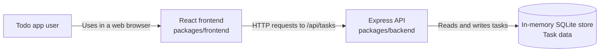
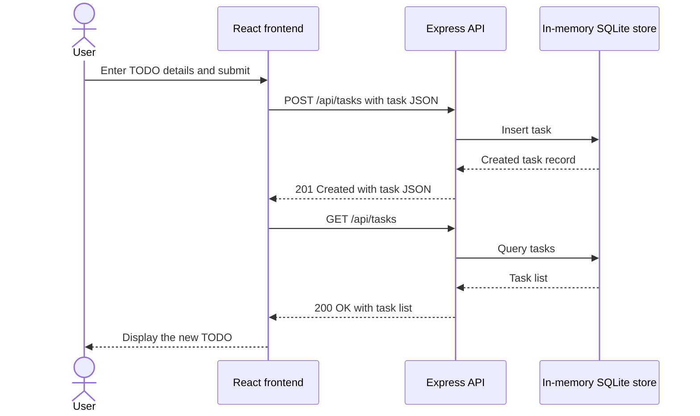

# Cloud Architecture Overview

## System Context

The repository is an npm-workspaces monorepo. The React frontend provides the browser experience and calls the Express API. The API persists task data only in its in-memory SQLite store, so data is lost when the API process restarts.

## Create a TODO

